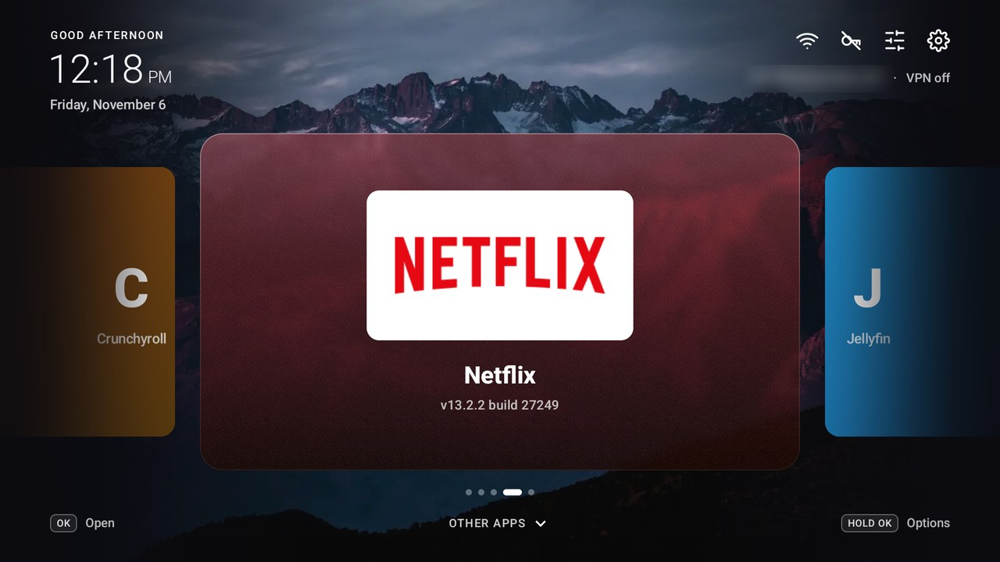
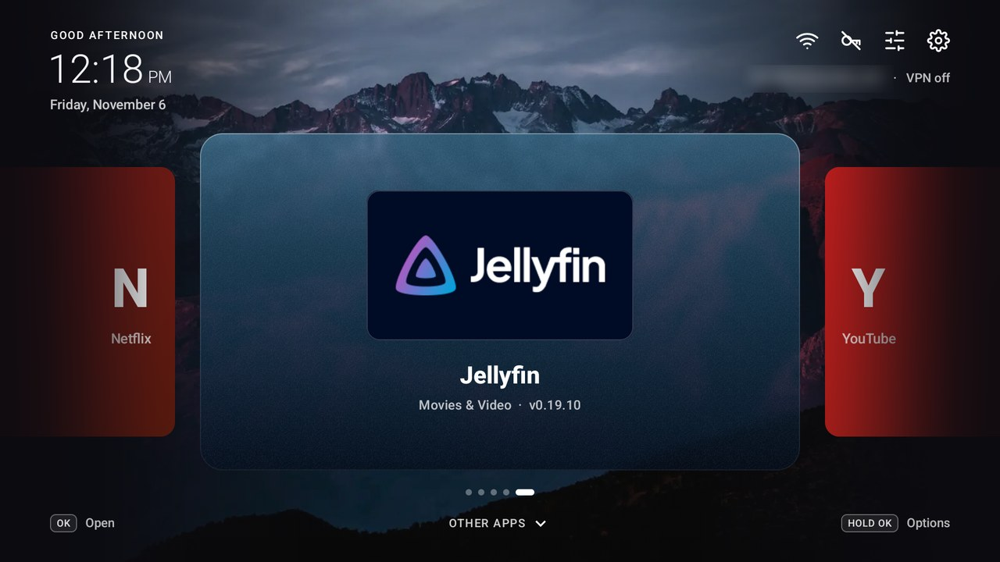
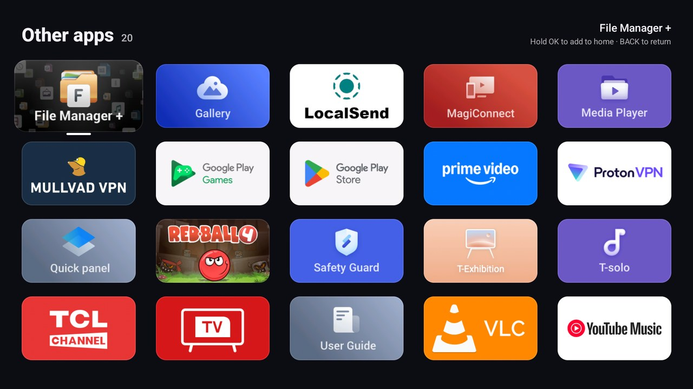
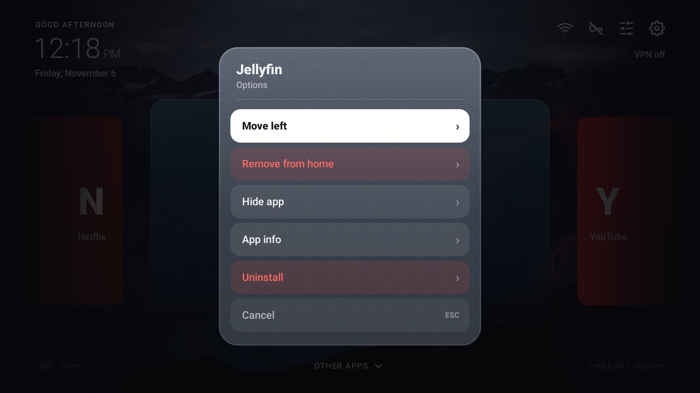
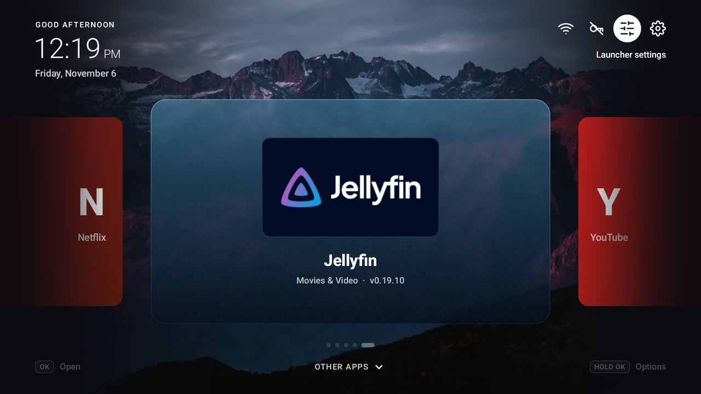
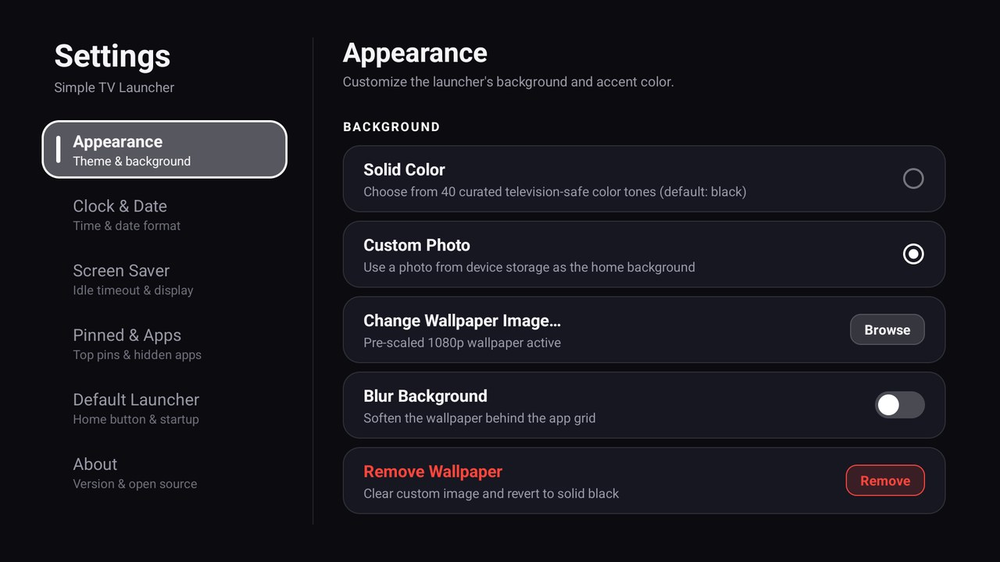
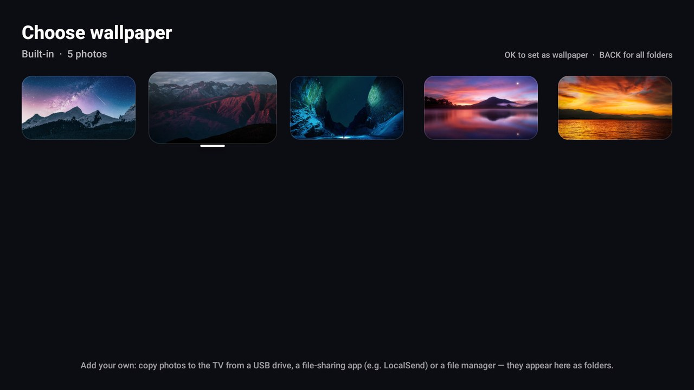

# Simple TV Launcher

**A clean, fast home screen for Android TV & Google TV.**

Your favourite apps in a frosted-glass carousel. Everything else one press away.
Under 1 MB, made for the remote.

[**⬇ Download the latest release**](https://github.com/mdev64/simple-tv-launcher/releases/latest)

## ✨ Highlights

- 🎞 **Carousel home.** Big cards for your pinned apps, tinted with each app's own colours.
- 📺 **Other apps, one press down.** Every app you haven't pinned, in a tidy grid.
- 🖼 **Make it yours.** Built-in wallpapers, your own photos, solid colours and an accent colour.
- 🕒 **Clock & date** in 12- or 24-hour format, or hidden.
- 🌙 **Screen saver.** Black screen, a floating clock, or a bouncing DVD-style word.
- 🏠 **Your real home screen.** Set it as the default launcher and the remote's Home button
  always brings you here, even right after the TV turns on.
- 🎮 **Remote-first.** Every screen works with the D-pad: no mouse, no touch.
- ⚡ **Tiny and quick.** No ads, no tracking, no account.

## 📸 Screens

| | |
|:---:|:---:|
|  |  |
| **Carousel**: step through your apps | **Other apps**: everything else |
|  |  |
| **Hold OK** to move, remove or hide an app | **Top bar**: Wi-Fi, VPN and settings |
|  |  |
| **Settings** | **Wallpaper picker** |

## 🚀 Install

1. Download `release-signed.apk` from the [latest release](https://github.com/mdev64/simple-tv-launcher/releases/latest).
2. Copy it to your TV (USB drive, LocalSend or a file manager) and open it to install.
3. Open **Simple TV Launcher**. To make it your Home button, see
   [Make it your default launcher](#-make-it-your-default-launcher) below.

## 🏠 Make it your default launcher

Set Simple TV Launcher as the TV's default launcher and it **takes over the Home button** on
your remote. Press Home from anywhere (inside Netflix, YouTube, TV settings, any app) and you
land straight back on your carousel. It also opens by itself when the TV starts, so you never
have to find it and launch it by hand.

1. Open Simple TV Launcher and press ▲ to reach the top bar.
2. Select the **launcher settings** button, then open the **Default Launcher** tab.
3. Choose **Set as Default Launcher**.
4. Your TV asks which home app to use. Pick **Simple TV Launcher** (choose **Always** if asked).

The **Current home status** card then shows **Active ✓**.

**Changing your mind?** In the same tab choose **Undo & Return to …** to give the Home button
back to the launcher you had before, or **Switch to …** for another one installed on the TV.
If your TV's stock launcher is disabled, the tab shows a shortcut to its App Info page so you
can turn it back on first.

> Some TVs (especially Google TV builds) don't show a chooser, or keep sending Home to their own
> launcher. If the Home button still opens the old screen, check your TV's
> **Settings → Apps → Default apps → Home app** (the name varies by brand).

## 🎮 Using it

| Button | What it does |
|---|---|
| ◀ ▶ | Move between your apps |
| **OK** | Open the app |
| **Hold OK** | Options: move, remove, hide, uninstall |
| ▼ | Other apps (hold OK there to add an app to home) |
| ▲ | Top bar: Wi-Fi, VPN, launcher settings, TV settings |

## 🛠 Building from source

See the [build & install guide](doc/BUILD.md).
